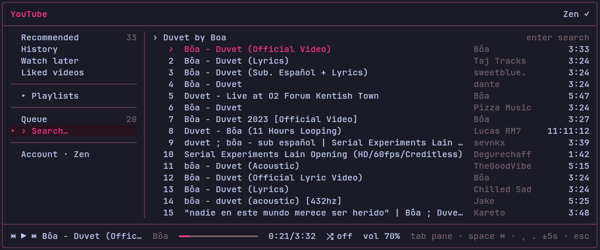
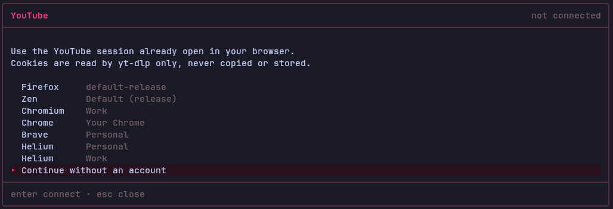

<div align="center">

# pi-yt

Reproducí tu biblioteca de YouTube desde [Pi](https://pi.dev) con la sesión de YouTube que ya tenés abierta en tu navegador.

[English](README.md) | Español

[](https://github.com/heohlee/pi-yt/actions/workflows/ci.yml)
[](https://github.com/heohlee/pi-yt/actions/workflows/security.yml)
[](https://www.npmjs.com/package/@heohlee/pi-yt)
[](LICENSE)

</div>

<p align="center">
  
</p>

## Cómo funciona

pi-yt no habla con YouTube directamente; usa yt-dlp y mpv:

1. **yt-dlp lee tu biblioteca** con `--cookies-from-browser` desde el perfil que elegiste, de a 50 temas.
2. **mpv reproduce el audio** en segundo plano. pi-yt resuelve cada stream con yt-dlp antes de pasárselo, y resuelve los temas siguientes por adelantado para que empiecen sin esperar.
3. **pi-yt controla mpv por su socket IPC**, y la línea de estado escucha el mismo socket, así que sigue mostrando lo que suena después de cerrar el overlay:

   ```
   ♪  Bôa - Duvet (Official Video) · 0:21/3:33
   ```

## Funciones

- **Overlay**: Recomendado, Historial, Ver más tarde, Videos que me gustan, Playlists, cola y búsqueda
- **Perfiles de Firefox, Zen, Chromium, Chrome, Brave y Helium**, o sin cuenta para solo buscar.
- **Reproducir todo, aleatorio, cola, avanzar o retroceder y volumen**.
- **Soporte completo del mouse**.
- **Línea de estado** en la barra de estado de Pi.
- **Instalación guiada**: si falta yt-dlp o mpv, `/yt` instala la versión oficial de yt-dlp (verificada con SHA-256) y explica cómo instalar mpv; también ofrece actualizar yt-dlp.

## Requisitos

- Pi con Node.js 24 o superior
- [mpv](https://mpv.io/)
- [yt-dlp](https://github.com/yt-dlp/yt-dlp)

### Plataformas

- **Linux**: soportado.
- **macOS**: sin probar.
- **Windows**: no soportado.

## Instalación

### Pi

```sh
pi install npm:@heohlee/pi-yt
```

### Desde GitHub

```sh
pi install git:github.com/heohlee/pi-yt
```

### Probarlo sin instalar

```sh
pi -e npm:@heohlee/pi-yt
```

### Gentle Shell

Estos comandos también funcionan en [Gentle Shell](https://github.com/Gentleman-Programming/gentle-shell): usá `gentle-shell <comando>` en lugar de `pi <comando>`.

## Uso

Ejecutá `/yt` y elegí el navegador donde tenés la sesión de YouTube iniciada:

<p align="center">
  
</p>

| Tecla     | Acción                                                         |
| --------- | -------------------------------------------------------------- |
| `tab`     | cambiar de panel                                               |
| `enter`   | abrir, reproducir desde el tema elegido, reproducir todo, aleatorio |
| `a`       | agregar a la cola                                              |
| `space`   | reproducir / pausar                                            |
| `n` / `p` | tema siguiente / anterior                                      |
| `.` / `,` | avanzar / retroceder 5 segundos                                |
| `+` / `-` | volumen                                                        |
| `/`       | buscar                                                         |
| `r`       | recargar la lista                                              |

## Privacidad

- Las cookies solo las lee yt-dlp; nunca se copian, registran ni guardan. `~/.config/pi-yt/config.json` guarda solo el navegador y el perfil.
- La búsqueda no envía tus cookies.
- `/yt` es un comando, no una herramienta del agente: tu historial nunca llega al modelo.
- La búsqueda de actualizaciones de yt-dlp es una sola consulta anónima a GitHub como máximo una vez por día, y solo para la copia que instaló `/yt`.

## Contribuir

Leé [CONTRIBUTING.md](CONTRIBUTING.md) para el flujo que empieza por un issue, los chequeos de desarrollo y las convenciones de los pull requests.

## Licencia

MIT
