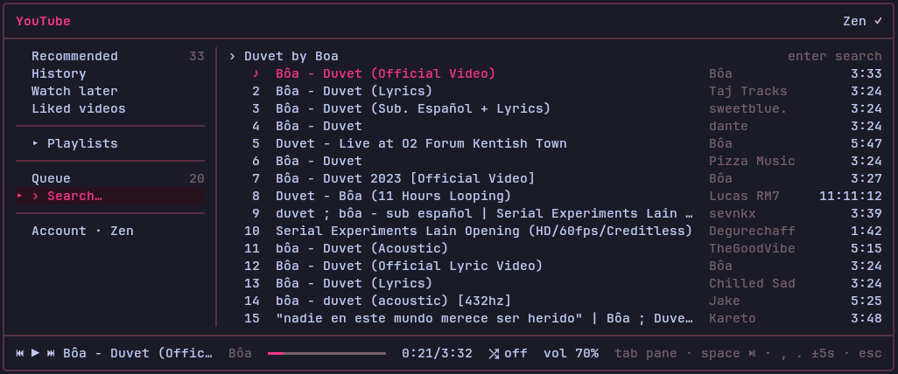
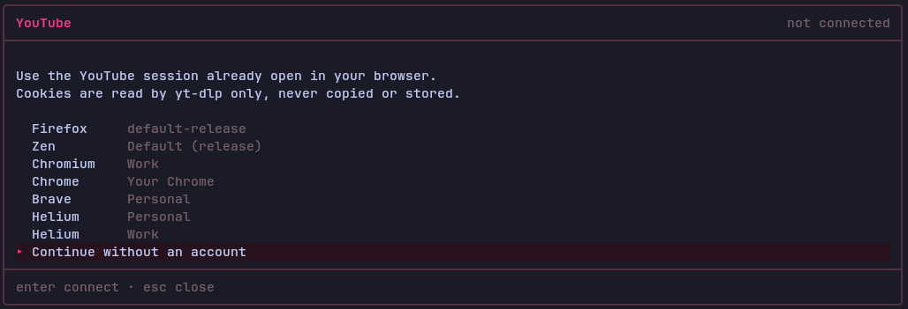

<div align="center">

# pi-yt

Play your YouTube library from [Pi](https://pi.dev) through the YouTube session already open in your browser.

[](https://github.com/heohlee/pi-yt/actions/workflows/ci.yml)
[](https://github.com/heohlee/pi-yt/actions/workflows/security.yml)
[](https://www.npmjs.com/package/@heohlee/pi-yt)
[](LICENSE)

</div>

<p align="center">
  
</p>

## How it works

pi-yt does not talk to YouTube itself; it drives yt-dlp and mpv:

1. **yt-dlp reads your library** with `--cookies-from-browser` from the profile you picked, 50 tracks at a time.
2. **mpv plays the audio** in the background. pi-yt resolves each stream with yt-dlp before handing it over, and resolves the next tracks ahead of time so they start without waiting.
3. **pi-yt controls mpv over its IPC socket**, and the status line listens to the same socket, so it keeps showing what is playing after you close the overlay:

   ```
   ♪  Bôa - Duvet (Official Video) · 0:21/3:33
   ```

## Features

- **Overlay**: Recommended, History, Watch later, Liked videos, Playlists, the queue and search 
- **Firefox, Zen, Chromium, Chrome, Brave and Helium** profiles, or no account to only search.
- **Play all, shuffle, queue, seek and volume**.
- **Full mouse support**
- **Status line** in Pi's status bar.
- **Guided setup**: if yt-dlp or mpv is missing, `/yt` installs the official yt-dlp release (verified by SHA-256) and tells you how to install mpv; it also offers yt-dlp updates.

## Requirements

- Pi on Node.js 24 or newer
- [mpv](https://mpv.io/)
- [yt-dlp](https://github.com/yt-dlp/yt-dlp)

## Install

### Pi

```sh
pi install npm:@heohlee/pi-yt
```

### From GitHub

```sh
pi install git:github.com/heohlee/pi-yt
```

### Try it without installing

```sh
pi -e npm:@heohlee/pi-yt
```

### Gentle Shell

These commands also work in [Gentle Shell](https://github.com/Gentleman-Programming/gentle-shell): use `gentle-shell <command>` in place of `pi <command>`.

## Usage

Run `/yt` and pick the browser where you are signed in to YouTube:

<p align="center">
  
</p>

| Key       | Action                                                |
| --------- | ----------------------------------------------------- |
| `tab`     | switch pane                                           |
| `enter`   | open, play from the selected track, play all, shuffle |
| `a`       | add to the queue                                      |
| `space`   | play / pause                                          |
| `n` / `p` | next / previous track                                 |
| `.` / `,` | forward / back 5 seconds                              |
| `+` / `-` | volume                                                |
| `/`       | search                                                |
| `r`       | reload the list                                       |

## Privacy

- Cookies are read by yt-dlp only, never copied, logged or stored; `~/.config/pi-yt/config.json` keeps only the browser and profile.
- Search does not send your cookies.
- `/yt` is a command, not an agent tool: your history never reach the model.
- The yt-dlp update check is one anonymous request to GitHub at most once a day, only for the copy `/yt` installed.

## Contributing

Read [CONTRIBUTING.md](CONTRIBUTING.md) for the issue-first workflow, development checks and pull request conventions.

## License

MIT
